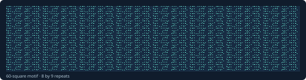

# Smaller counterexamples to Fuglede’s conjecture in the plane

Can a shape either tile the plane by sliding copies of itself, or admit a complete set of mutually orthogonal exponential waves? Fuglede conjectured these two properties went together. [Tao Zhang’s July 2026 preprint](https://arxiv.org/abs/2607.15632v1) constructed counterexamples in both directions. Here we verify his finite seeds independently and give two compact, explicit ways to lift them to the plane.

| Shape made of half-open unit squares | Tiles by translation | Has an exponential basis |
| --- | --- | --- |
| **4,320 squares** | No | Yes |
| **37,800 squares** | Yes | No |



The **4,320-square** example uses about **131 times fewer squares** than the 564,540-square example displayed in Zhang’s Corollary 4.5. The new proof checks that a 437 × 99 window can hold at most ten translation origins. A tiling would require more origins per unit area. The second example gives a concrete repeat count for the other direction, which Zhang’s Corollary 3.5 states for sufficiently large repeats.

## Check the result

Read the [proof and construction formulas](PROOF.md) and the [independent audit](INDEPENDENT-AUDIT.md). Run both standard-library replays with Node.js 18 or later, from this directory:

```sh
node verify.js
node independent-verify.js
```

The replays use exact finite arithmetic and certify the numerical Fourier bounds with rational error estimates. The proof explains why the finite checks imply statements about the whole plane.

**Credit and scope.** Zhang discovered the original planar counterexamples and both finite seeds. The contributions here are the smaller explicit lifts, the packing-density certificate, and independent verification. This is AI-assisted work, not externally peer reviewed. We do not claim minimum size, first priority, or a result about finite-field grids or the real line.
