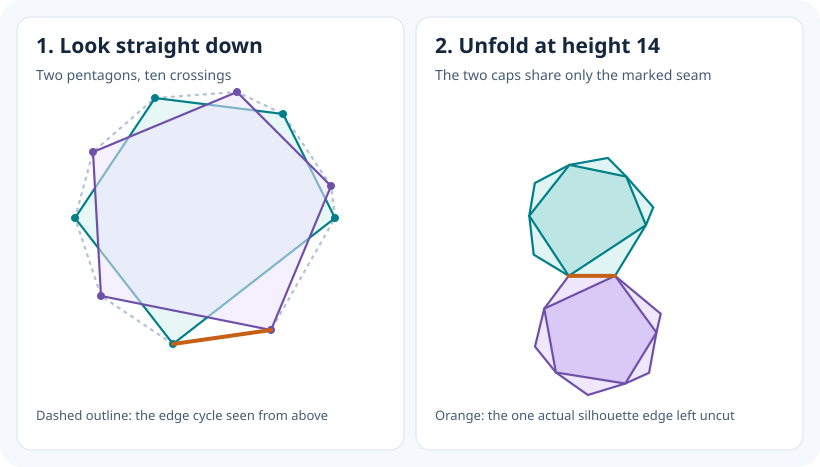

# Cutting a convex solid flat along one edge path

Can you cut a convex solid along its existing edges and flatten it into one piece without any overlap? That is Dürer's unfolding problem. This result gives a way to do it for a particular family, not for all convex solids.



**The trick:** look down on two staggered polygons, one above the other. Their outer outline lifts to a cycle through every vertex. Split the solid into two caps along that cycle, flatten them, and join them back along **one** edge. If that edge supports both flattened caps, the two pieces can sit on opposite sides of it and cannot overlap. Cutting the rest of the cycle gives a single edge path.

**Exact example:** the same cut works over a whole height interval, 0 < h ≤ 30, in a ten-vertex solid whose projected bases cross ten times. At height 14 the independent verifier checked all 56 cycles that visit every vertex and found that none meets the usual quasigeodesic angle condition. This cut still works.

- [Construction, proof and the ten rational coordinates](SILHOUETTE.md)
- [Independent derivation and full cycle audit](INDEPENDENT-DURER-AUDIT.md)

Run the two dependency-free exact checks with Node.js:

```sh
node verify-silhouette.cjs
node independent-durer.cjs
```

The illustration uses rounded coordinates. The proofs and verifiers do not. Results were independently checked within this AI-assisted project and have not been peer reviewed.
